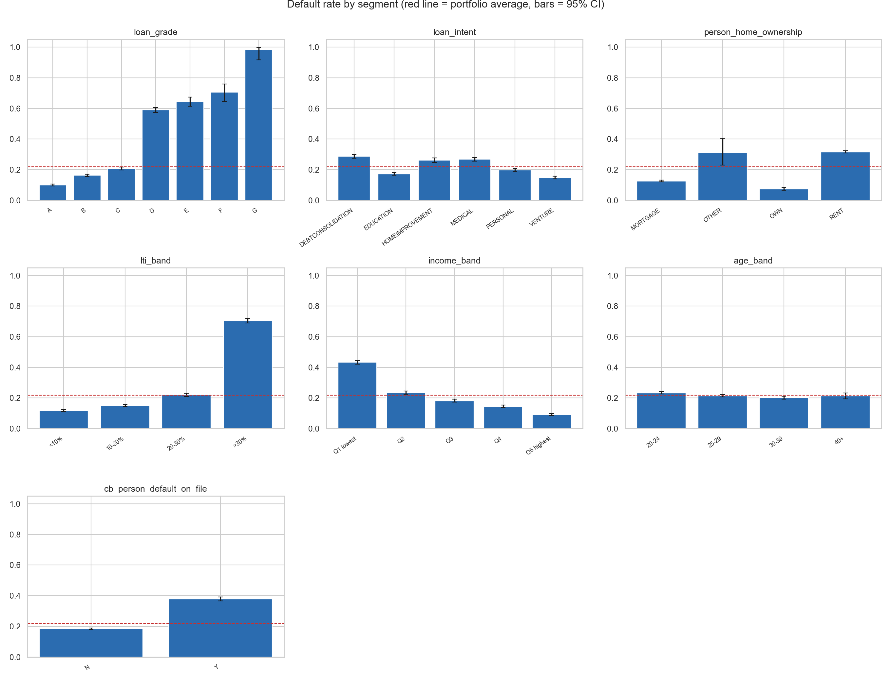
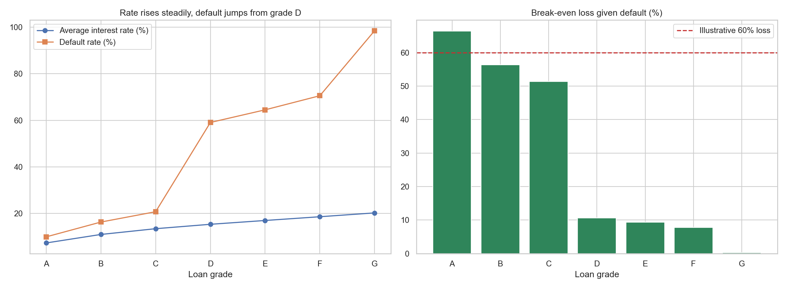
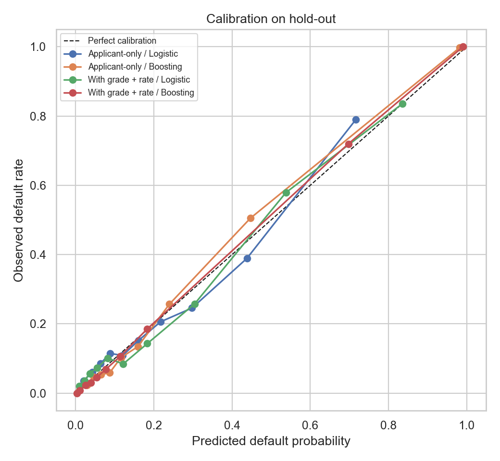
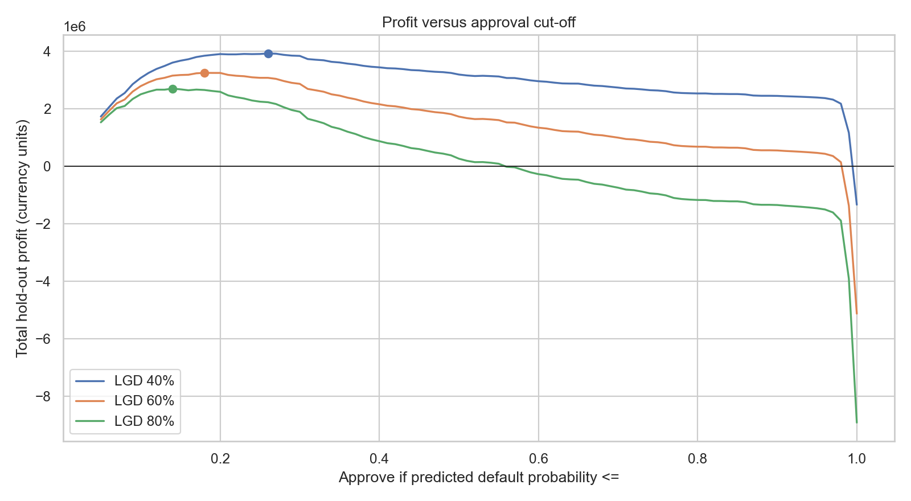

# Is the Lender Paid for the Risk? A Credit Pricing and Approval Audit

An analysis of 32,581 personal loans testing two things: whether the interest rate charged in each loan grade covers that grade's default risk, and whether a risk-based approval cut-off would have improved expected profit.

> Educational analysis. The dataset is anonymised and undocumented (source, currency, loan term and recoveries are unknown), so profit figures rest on stated assumptions and are not a real lender's P&L.

## Project at a glance

- **Question:** Does the rate cover the default risk by grade, and what approval policy maximises expected profit?
- **Data:** `credit_risk_dataset.csv`, 32,581 rows, 12 columns. Target `loan_status` (1 = default); overall default rate 21.8%.
- **Notebook:** [`credit_risk_pricing_audit.ipynb`](credit_risk_pricing_audit.ipynb)
- **Status:** the notebook has not been fully executed end to end. The numbers in the data profile below were checked on the file; model, break-even and policy results must come from your own run.

## What makes it different

Most credit-risk projects stop at a classifier and an AUC score. This one starts from the lender's decision:

1. **Pricing adequacy.** For each grade it computes the break-even loss given default, $$L^{*} = \frac{(1-p)\,r}{p}$$, the recovery loss at which the grade earns exactly zero. It is checked against 40%, 60% and 80% loss assumptions.
2. **Honest model comparison.** An applicant-only model is compared with one that also sees the lender's grade and rate, which may already encode the lender's own view.
3. **Policy simulation with sensitivity.** Approval cut-offs are swept on a held-out set under three loss assumptions, so the conclusion does not hang on one guess.
4. **Uncertainty and effect size.** Default rates carry 95% Wilson intervals, and chi-square tests report Cramer's V.
5. **Fairness check** by age band, with a note on why age should not drive real credit decisions.

## Data profile (verified on the uploaded file)

| Column | Meaning |
|---|---|
| `person_age`, `person_income`, `person_emp_length` | Applicant age, annual income, years employed |
| `person_home_ownership` | RENT, MORTGAGE, OWN, OTHER |
| `loan_intent`, `loan_grade`, `loan_amnt`, `loan_int_rate` | Purpose, grade A to G, amount, interest rate (%) |
| `loan_percent_income` | Loan amount divided by income |
| `cb_person_default_on_file`, `cb_person_cred_hist_length` | Prior default flag, credit history length |
| `loan_status` | Target: 1 = default |

Data issues found and how the notebook handles them:

- **165 exact duplicate rows**, removed (32,416 remain).
- **Missing values:** 895 in `person_emp_length` and 3,116 in `loan_int_rate`. Both get a missingness flag; the rate is filled with the grade median only for the pricing maths.
- **Impossible values:** 5 ages above 100 (maximum 144) and 2 employment lengths above 60 (maximum 123). These are set to missing, not dropped.
- **Observed default rate by grade (raw file):** A 10.0%, B 16.3%, C 20.7%, D 59.0%, E 64.4%, F 70.5%, G 98.4%. The jump from grade D onward is far steeper than the rate increase, which is what the pricing test examines.

## Repository structure

credit-risk-pricing-audit/
├── README.md
├── credit_risk_pricing_audit.ipynb
├── requirements.txt
├── .gitignore
├── data/
│   └── credit_risk_dataset.csv     # local only unless the licence allows redistribution
└── images_credit/                  # created when the notebook runs

The notebook reads `credit_risk_dataset.csv` from the notebook folder. If you keep it in `data/`, change `DATA_PATH` in the first code cell to `Path('data/credit_risk_dataset.csv')`.

## How to run

1. Install Python 3.10 or newer and Jupyter.
2. `python -m pip install -r requirements.txt`
3. Place the CSV as described above.
4. Open the notebook, choose **Restart Kernel and Run All**, and fix any path error before reading results.

## Analysis workflow

1. **Audit and clean** duplicates, missing values and impossible values.
2. **Engineer** income, loan-to-income and age bands, plus missingness flags.
3. **Segment default rates** with confidence intervals, then chi-square tests and Cramer's V.
4. **Pricing adequacy** by grade through the break-even loss.
5. **Models:** logistic regression and gradient boosting, applicant-only versus with grade and rate; ROC-AUC, Brier score, calibration curve on a stratified 25% hold-out.
6. **Approval simulation** at LGD of 40%, 60% and 80%.
7. **Fairness check** by age band.

## Visuals (created by the notebook in `images_credit/`)

Run the notebook and commit these four files; until then the links appear broken.

## Results

Complete after a successful run, using only printed values.

- **Pricing:** [grades with break-even LGD below 60%, and their share of loans]
- **Risk concentration:** [segments with the highest default rates and largest Cramer's V]
- **Model value:** [AUC and Brier, applicant-only versus with grade and rate]
- **Policy:** [best cut-off, approval rate and profit versus approve-all, at each LGD]
- **Fairness:** [approval rate by age band]

## Limitations

- Loan term, collateral, fees, funding cost and recoveries are not in the data; the profit model is one period with an assumed loss given default.
- Default rates of 59% to 98% in grades D to G are far above real lending books, which points to synthetic or heavily sampled data. Use the project for method, not real-world benchmarks.
- Rows are loans, not unique borrowers.
- The best cut-off is chosen on the same hold-out set it is scored on, so the profit is optimistic.
- Results show association, not causation. Age and similar attributes should not drive real credit decisions.
